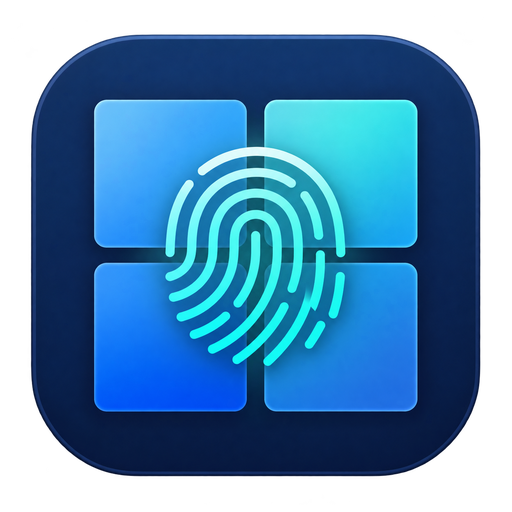

# WinHello

WinHello là phần mềm mã nguồn mở theo giấy phép [MIT](LICENSE).

<p align="center"></p>

WinHello cho phép duyệt yêu cầu đăng nhập Windows bằng sinh trắc học trên điện thoại Android khi hai thiết bị ở cùng mạng LAN. Điện thoại gửi TOTP và chữ ký của challenge; LAN Agent xác minh trước khi Credential Provider chuyển mật khẩu Windows đã lưu cho Winlogon.

> **Bản thử nghiệm.** Giữ phương thức đăng nhập Windows bằng mật khẩu để dự phòng. Mật khẩu Windows được mã hóa trên PC lúc đăng ký; TOTP và vân tay trên điện thoại không thay thế cơ chế xác thực tài khoản của Windows.

## Tải xuống

Các bản phát hành nằm tại [GitHub Releases](https://github.com/interface-daodung/WinHello/releases). Mỗi phiên bản có:

| Tệp | Công dụng |
| --- | --- |
| `WinHello-verX.Y.Z-windows-x64-setup.exe` | Bộ cài Inno Setup 7 cho CLI `winhello` và các binary Windows x64 |
| `WinHello-verX.Y.Z-android.apk` | Ứng dụng Android ký bằng release keystore để cập nhật cài đè |
| `WinHello-verX.Y.Z-SHA256SUMS.txt` | SHA-256 để kiểm tra tệp tải xuống |

Windows installer hiện chưa ký mã; Windows có thể hiện cảnh báo nhà phát hành chưa xác minh. Hãy giữ nguyên Android Release Keystore cho mọi bản cập nhật để Android cài đè mà không mất dữ liệu app.

WinGet: manifest `daodung183.WinHello` đã được gửi trong [PR #464619](https://github.com/microsoft/winget-pkgs/pull/464619) và đang chờ duyệt. Khi gói xuất hiện trong danh mục WinGet, có thể cài bằng `winget install --id daodung183.WinHello -e`.

## Cài đặt nhanh

1. Cài Windows installer, mở **CMD mới** và gõ `winhello h`.
2. Gõ `winhello regi`. Chấp nhận yêu cầu quyền Administrator, nhập mật khẩu Windows của tài khoản cần đăng nhập. QR TOTP xuất hiện ngay trong terminal và không được lưu thành ảnh.
3. Gõ `winhello app` để hiện QR tải APK Android. Trong app, nhấn **+**, quét QR TOTP từ `winhello regi` và xác nhận ghép đôi.
4. Khi Windows yêu cầu đăng nhập, app tự tìm PC trên LAN. Nhấn biểu tượng khóa cạnh PC và xác nhận vân tay/sinh trắc học trên điện thoại.

Sau khi ghép đôi, chạy `winhello fast on` (3 ngày) hoặc `winhello fast 1` đến `winhello fast 30` trên PC, rồi quét QR bằng app. Kích hoạt cần xác nhận vân tay một lần và điện thoại phải có khóa màn hình. Trong thời gian hiệu lực, điện thoại đã mở khóa có thể duyệt mở PC bằng một chạm. Xem trạng thái bằng `winhello fast`; thu hồi trên PC bằng `winhello fast off`.

Muốn gỡ WinHello khỏi một PC đã ghép đôi, hãy mở khóa Windows trên PC đó, rồi nhấn biểu tượng thùng rác trong app và xác nhận sinh trắc học. LAN Agent thu hồi ghép đôi; tùy chọn WinHello sẽ không còn xuất hiện ở màn đăng nhập kế tiếp. Nếu PC offline, app chỉ xóa dữ liệu trên điện thoại; PC chưa nhận được lệnh thu hồi.

| Lệnh CMD | Tác dụng |
| --- | --- |
| `winhello` hoặc `winhello h` | Hiện trợ giúp |
| `winhello regi` | Đăng ký nếu chưa có; báo “already registered” nếu đã đăng ký |
| `winhello app` | Hiện QR và URL APK mới nhất từ máy chủ cập nhật |
| `winhello update` | Kiểm tra, tải và mở trình cài đặt bản Windows mới nhất |
| `winhello pair` | Liệt kê điện thoại đang ghép với PC này |
| `winhello rm` | Xóa cấu hình WinHello trên PC (pairing, TOTP, chứng chỉ và mật khẩu đã lưu); lần `regi` tiếp theo tạo mã mới và yêu cầu nhập mật khẩu Windows |
| `winhello fast [on|1-30|off]` | Xem trạng thái, tạo QR kích hoạt hoặc thu hồi Mở máy nhanh |
| `winhello v` | Hiện phiên bản |
| `winhello uninstall` | Gỡ Credential Provider, service và dữ liệu ghép đôi |

Hai lệnh cập nhật dùng Worker URL ổn định trong `config/update-server.json`. Máy chủ phân phối và Cloudflare Tunnel được quản lý tự động qua TunnelDrop (`hub start` / `hub status` / `hub ui`). APK build mới mặc định kiểm tra qua Worker. Xem [cấu hình Worker lần đầu](docs/release.md#cloudflare-worker-and-quick-tunnel).

Android giữ các PC đã ghép trong danh sách khi offline; màn hình chính tự dò LAN mỗi 5 giây. Trạng thái **Đã mở/Đã khóa** lấy từ Windows qua HTTPS có ghim chứng chỉ. Nút thông tin **ⓘ** trong app giải thích các thao tác.
Khi app đóng, widget không quét nền. Nhấn **↻ Quét PC** trên widget để kiểm tra một lần; nếu PC có yêu cầu đăng nhập, widget hiện nút **Duyệt mở khóa** và mở thẳng xác nhận sinh trắc học.

## Cấu trúc mã nguồn

| Thư mục | Thành phần |
| --- | --- |
| `apps/android/` | Ứng dụng Java, widget, QR, TOTP và sinh trắc học |
| `apps/lan-agent/` | Windows Service .NET, HTTPS, UDP discovery và named pipe |
| `apps/credential-provider/` | DLL C++/COM cho LogonUI |
| `cli/` | Lệnh TUI `winhello` |
| `contracts/` | Hợp đồng HTTP và named pipe |
| `packaging/` | Cấu hình Inno Setup 7 |
| `scripts/` | Build, cài đặt, cập nhật và gỡ |

Xem thêm [kiến trúc](docs/architecture.md), [hướng dẫn cài/gỡ](INSTALL.md) và [hợp đồng giao tiếp](contracts/README.md).

## Build từ mã nguồn

Trên Windows với .NET 10 SDK, LLVM-MinGW, Android SDK/Gradle và Inno Setup 7 x64:

```powershell
powershell.exe -NoProfile -ExecutionPolicy Bypass -File .\scripts\build-release.ps1
```

Installer, APK and checksums are created in `publish/`. The folder is ignored by Git. Use TunnelDrop (`hub start` / `hub ui`) to expose them through the stable Worker URL. See [release instructions](docs/release.md).

