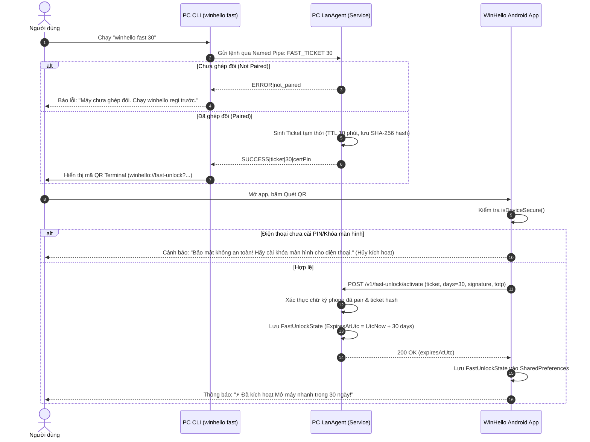
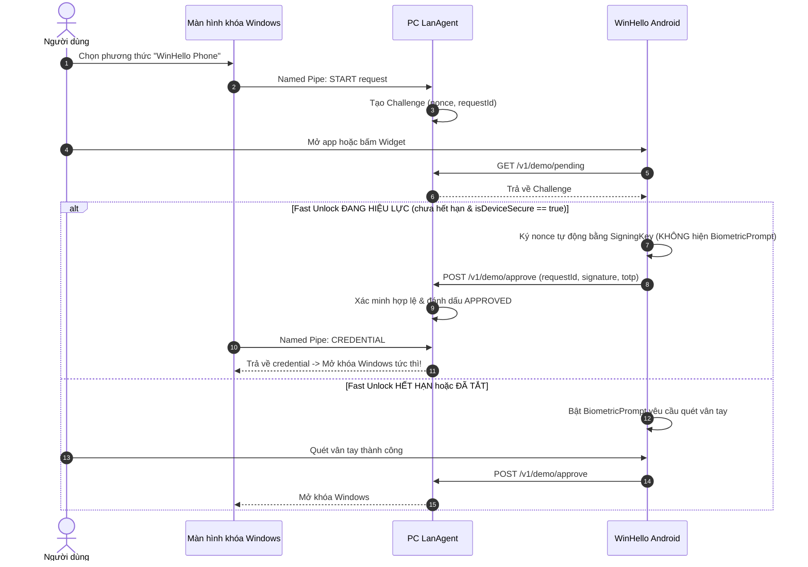

# Kế Hoạch Triển Khai Tính Năng "Mở Máy Nhanh" (`winhello fast`)

Tài liệu này mô tả chi tiết thiết kế kỹ thuật, kiến trúc bảo mật và các bước triển khai tính năng **Mở máy nhanh** cho giải pháp WinHello, thay thế bản thử nghiệm `otp3` trước đây bằng cơ chế chuẩn hóa chính thức trên nhánh `main`.

---

## 1. Tổng Quan & Yêu Cầu Nghiệp Vụ

### 1.1. Mục tiêu
- Cung cấp tùy chọn **Mở máy nhanh** trong khoảng thời gian linh hoạt (mặc định 3 ngày, tối đa 30 ngày, ví dụ: `winhello fast 15`, `winhello fast 30`).
- Trong thời gian hiệu lực, khi mở khóa Windows qua điện thoại, người dùng **không cần quét lại vân tay** (hoặc mở 1 chạm từ màn hình/widget), giúp trải nghiệm mở máy cực nhanh và thuận tiện.
- Hết thời gian định sẵn (Time-To-Die - TTL), hệ thống tự động quay về yêu cầu quét vân tay sinh trắc học như bình thường.

### 1.2. Các quy tắc cốt lõi (User Constraints)
1. **Chỉ bật được khi đã ghép đôi (Paired)**:
   - Lệnh `winhello fast <days>` chỉ được phép tạo mã QR nếu PC **đã hoàn thành ghép đôi (`winhello regi`)** với điện thoại trước đó.
   - Nếu chưa pair, PC lập tức từ chối và báo lỗi, tuyệt đối không sinh mã QR rác.
2. **Chỉ tắt được trên PC**:
   - Điện thoại không có nút tắt mở nhanh để tránh xung đột trạng thái hoặc vô tình bấm nhầm.
   - Muốn thu hồi hoặc tắt mở nhanh, người dùng phải chạy lệnh trực tiếp trên máy tính: `winhello fast off`.
3. **Bắt buộc khóa màn hình điện thoại (`KeyguardManager.isDeviceSecure()`)**:
   - Điện thoại bắt buộc phải có màn hình khóa (mã PIN, mật khẩu, hình vẽ hoặc vân tay).
   - Nếu điện thoại không cài khóa màn hình, app Android sẽ chặn kích hoạt Mở máy nhanh và hiển thị cảnh báo bảo mật.
4. **Chuẩn hóa tên gọi chính thức**:
   - Đổi toàn bộ các khái niệm thử nghiệm `otp3` thành `winhello fast` và URI `winhello://fast-unlock`.
5. **Thực hiện trên nhánh `main`**:
   - Đã chuyển nhánh làm việc về `main` (sạch sẽ, không dính mã tạm của nhánh dev).

---

## 2. Kiến Trúc Luồng Hoạt Động

### 2.1. Luồng Kích Hoạt Mở Máy Nhanh



### 2.2. Luồng Mở Khóa Windows Khi Đang Bật Mở Nhanh



---

## 3. Thiết Kế Chi Tiết Từng Thành Phần

### 3.1. Windows CLI (`cli/winhello.ps1`)
Bổ sung nhánh lệnh `fast`:
- `winhello fast`: Hiển thị trạng thái mở nhanh hiện tại (Đang Bật - Còn X ngày / Đang Tắt).
- `winhello fast <days>`:
  - Kiểm tra `$days` hợp lệ (từ 1 đến 30, ví dụ: 3, 7, 15, 30).
  - Kết nối Named Pipe `WinHello.LanAgent` gửi lệnh: `FAST_CREATE <days>`.
  - Nếu kết quả là `NOT_PAIRED`: In thông báo lỗi màu vàng/đỏ:
    > "Không thể bật Mở máy nhanh. Máy tính này chưa được ghép đôi với điện thoại nào! Vui lòng chạy 'winhello regi' để ghép đôi trước."
  - Nếu kết quả hợp lệ: Sinh và vẽ mã QR ra Terminal với định dạng:
    `winhello://fast-unlock?pcid=<PC_ID>&ticket=<TICKET>&days=<DAYS>&pin=<CERT_PIN>&name=<PC_NAME>`
- `winhello fast off`:
  - Gửi lệnh Named Pipe: `FAST_OFF`.
  - LanAgent xóa file/bộ nhớ trạng thái Fast Unlock.
  - In thông báo: `[✓] Đã tắt tính năng Mở máy nhanh trên máy tính này. Các lần đăng nhập tiếp theo sẽ yêu cầu quét vân tay.`

### 3.2. Windows LAN Agent (`apps/lan-agent/Program.cs`)
1. **Model trạng thái `FastUnlockRecord`**:
   - `Days`: Số ngày đăng ký (ví dụ 15, 30).
   - `ActivatedAtUtc`: Thời điểm kích hoạt.
   - `ExpiresAtUtc`: Thời điểm hết hạn chính xác.
   - `PhoneDeviceId`: Thiết bị điện thoại được ủy quyền.
   - Lưu trữ an toàn tại `%ProgramData%\WinHelloLanDemo\fast-unlock.json`.
2. **Named Pipe Server mở rộng**:
   - `FAST_STATUS`: Trả về `ACTIVE|<days>|<expiresUtc>` hoặc `INACTIVE`.
   - `FAST_CREATE <days>`: Kiểm tra `state.IsPaired`. Nếu false -> `ERROR|not_paired`. Nếu true -> sinh ticket tạm 10 phút, hash SHA-256.
   - `FAST_OFF`: Thu hồi trạng thái Fast Unlock ngay lập tức.
3. **Endpoint HTTP REST**:
   - `POST /v1/fast-unlock/activate`: Nhận ticket, xác minh signature từ điện thoại đã pair, lưu trạng thái.
   - `GET /health` hoặc `/v1/status`: Bổ sung cờ `fastUnlock: { active: bool, expiresAt: string }` để điện thoại nhận biết khi quét mạng.

### 3.3. Android App (`apps/android`)
1. **Kiểm tra bảo mật thiết bị (`KeyguardManager`)**:
   ```java
   KeyguardManager km = (KeyguardManager) getSystemService(Context.KEYGUARD_SERVICE);
   if (!km.isDeviceSecure()) {
       // Từ chối kích hoạt, cảnh báo người dùng bật PIN/vân tay
   }
   ```
2. **Xử lý quét mã QR Mở máy nhanh**:
   - Nhận diện Scheme: `winhello://fast-unlock`.
   - Kiểm tra `pcid` trùng với PC đang ghép đôi. Nếu khác -> Báo lỗi.
   - Hiển thị Dialog xác nhận: `"Kích hoạt Mở máy nhanh trong {X} ngày cho máy {PC_NAME}?"`.
   - Gửi yêu cầu kích hoạt lên PC và lưu `fastUnlockExpiresAt` vào `PcStatusStore`.
3. **Cập nhật Giao diện (UI Updates)**:
   - **Thẻ máy tính (PC Card)**:
     - Khi Mở máy nhanh đang hoạt động: Hiển thị biểu tượng tia sét kèm nhãn:  
       `⚡ Mở máy nhanh: Còn X ngày` (màu xanh ngọc).
     - Ghi chú hướng dẫn nhỏ phía dưới: `(Tắt trên máy tính bằng lệnh 'winhello fast off')`.
   - **Hành động Duyệt mở khóa (Approve)**:
     - Nếu `Fast Unlock` còn hiệu lực: Nút hiển thị `⚡ Mở nhanh`. Nhấn vào sẽ tự động gửi chữ ký duyệt mà không hiện popup vân tay.
     - Nếu đã hết hạn hoặc đang tắt: Hiển thị `Duyệt mở khóa`, nhấn vào sẽ hiện popup vân tay `BiometricPrompt` bảo mật.
   - **Widget**:
     - Đồng bộ trạng thái: hiển thị nút Duyệt mở nhanh 1 chạm khi Fast Unlock đang bật.

---

## 4. Phân Tích Rủi Ro & Cơ Chế Giảm Thiểu (Security Matrix)

| Rủi Ro | Khả Năng | Giải Pháp Kỹ Thuật Trong Thiết Kế |
|---|---|---|
| Người lạ mượn điện thoại mở máy tính | Trung bình | Bắt buộc bật khóa màn hình (`isDeviceSecure`). Nếu ai đó mượn điện thoại đang khóa, họ không thể vào app WinHello để mở máy. |
| Kẻ gian tạo QR mở nhanh khi chưa pair PC | Thấp | Chặn hoàn toàn ở tầng Agent: chỉ PC đã `IsPaired == true` mới sinh được QR. |
| Mã QR mở nhanh bị chụp lén | Thấp | Ticket QR chỉ có giá trị trong 10 phút, chỉ điện thoại có private key đã pair mới kích hoạt được. |
| Quên tắt khi cho mượn PC | Trung bình | TTL tự hủy tối đa 30 ngày. Luôn có thể tắt tức thì bằng `winhello fast off`. |
| Điện thoại gỡ mã PIN sau khi kích hoạt | Thấp | Mỗi lần bấm mở nhanh, app kiểm tra lại `km.isDeviceSecure()`. Nếu phát hiện đã tắt PIN -> hủy mở nhanh ngay lập tức. |

---

## 5. Kế Hoạch Các Bước Thực Hiện

1. **Bước 1: Triển khai trên PC Agent & CLI**
   - Viết logic `FastUnlockState`, ticket tạm thời, và các lệnh Named Pipe (`FAST_CREATE`, `FAST_OFF`, `FAST_STATUS`) trong `apps/lan-agent/Program.cs`.
   - Bổ sung lệnh `winhello fast [days|off]` trong `cli/winhello.ps1`.
   - Thêm REST API `/v1/fast-unlock/activate`.
2. **Bước 2: Triển khai trên Android App**
   - Cập nhật `LanClient.java` để hỗ trợ gọi API kích hoạt Fast Unlock và lưu trạng thái TTL.
   - Thêm kiểm tra `KeyguardManager.isDeviceSecure()` trong `MainActivity.java`.
   - Cập nhật UI `MainActivity` (thẻ thiết bị, hiển thị badge còn X ngày, nút Duyệt mở nhanh).
   - Cập nhật `WidgetApprovalActivity.java` để hỗ trợ mở nhanh từ Widget.
3. **Bước 3: Biên dịch & Kiểm thử End-to-End**
   - Biên dịch Windows Agent (`dotnet build`).
   - Biên dịch Android Debug APK (`./gradlew assembleDebug`).
   - Kiểm tra các ca:
     + Chạy `winhello fast 30` khi chưa pair -> kiểm tra báo lỗi.
     + Chạy sau khi pair -> tạo QR thành công.
     + Quét trên máy Android không có mã PIN -> kiểm tra chặn kích hoạt.
     + Quét trên máy Android có mã PIN -> kích hoạt thành công, mở máy không cần vân tay.
     + Chạy `winhello fast off` trên PC -> hủy thành công, quay về vân tay.
